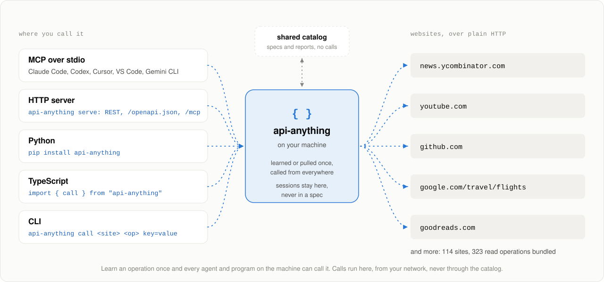

<div align="center">

<picture>
  <source media="(prefers-color-scheme: dark)" srcset="docs/media/hero-dark.svg">
  
</picture>

**When an agent needs a website that has no API, it learns one. Every other agent gets it for free.**<br>
Learned from the site's own requests, called over plain HTTP, verified and repaired by the agents that use it.

[](https://www.npmjs.com/package/api-anything)
[](https://api-anything-registry.forth-site.workers.dev)
[](https://github.com/goodnight000/api-anything/actions/workflows/ci.yml)
[](LICENSE)
[](INSTALL.md)

[Quick&nbsp;start](#quick-start) · [Example](#whos-talking-about-your-project) · [The&nbsp;race](#the-race) · [How&nbsp;it&nbsp;works](#how-it-works) · [Use&nbsp;it&nbsp;anywhere](#use-it-anywhere) · [Catalog](#the-shared-catalog) · [Safety](#safety-and-what-leaves-your-machine) · [Docs](#docs)

</div>

Goodreads stopped giving out API keys in 2020. Google Flights never had a public API. An agent that
needs either one drives a browser: it clicks, waits, reads the screen, and pays for every step in
time and tokens. API Anything learns the request the site's own page sends, once, and then calls it
over plain HTTP. It shares what it learned, with every cookie and token stripped out, so the next
agent gets JSON from one request.

## Quick start

```sh
npx -y api-anything setup
```

Setup lists the agents it finds (Claude Code, Codex, Cursor, Claude Desktop, Gemini CLI, VS Code)
and asks which to connect the MCP server and the skill to; `--agents` names them instead, and the
always-on Hermes gateway is added only by name. Then it asks whether to help build the shared
catalog. `setup --local-only` keeps everything on this machine. Node 22.13 or newer; no account, no API key. Or tell your coding agent: *Set up API
Anything for me: https://github.com/goodnight000/api-anything/blob/main/INSTALL.md*.
[What setup changes, and every client](docs/QUICKSTART.md)

Restart the agent and ask it something like *"What does Goodreads rate Piranesi?"*, or call an
operation yourself:

```sh
npx -y api-anything call hacker-news search query=sqlite
```

```text
{"ok":true,"class":"ok","tier":1,"data":[
  {"title":"Hosting SQLite databases on GitHub Pages or any static file hoster", ...}, ...],
 "ms":185}
```

`tier: 1` means one plain HTTP request, with no browser and no account. A failure says what
happened (`class`), why (`reason`) and what to do next (`next`).

## Who's talking about your project

You shipped something. Is anyone talking about it? Finding out means five search pages, or five
different APIs with their own keys, OAuth apps and client libraries.
[`examples/mentions.mjs`](examples/mentions.mjs) asks Hacker News, Reddit, YouTube, GitHub and
Mastodon at once, from an empty home, with no account:

[](docs/demos/README.md#6-whos-talking-about-a-project)

The core of it is six reads in parallel, each capped at plain HTTP:

```js
import { call } from "api-anything";

const sources = [
  ["hacker-news", "searchByDate", { query: project }],
  ["hacker-news", "searchByDate", { query: project, type: "comment" }],
  ["reddit", "search", { query: project }],
  ["youtube", "search", { q: project, filter: uploaded }],
  ["github", "searchRepos", { q: `${project} created:>${sinceDay}` }],
  ["mastodon", "tagTimeline", { tag: project }],
];
const results = await Promise.all(sources.map(([site, op, args]) => call(site, op, args, { maxTier: 1 })));
```

Run it from a checkout after `npm ci`: `node examples/mentions.mjs <project>`, with `--days 30`
for a wider window or `--json` for every link, for a script or a cron job.

On 2026-11-06, five runs from empty homes took 1.8 to 2.0 s each, Node's start included. Every run
found the same 65 mentions. YouTube, GitHub, Mastodon and both Hacker News searches answered over
plain HTTP. Reddit served a JavaScript challenge every time, and the script reported it as `blocked`
and kept the rest. [Transcript and details](docs/demos/README.md#6-whos-talking-about-a-project)

## The race

Same agent, same prompt, started together. Left: it drives headless Chrome. Right: it calls API
Anything's Google Flights operation.

[](docs/media/agent-race.mp4)

<p align="center"><b>1.5 to 2× sooner · about half the tokens · the same cost or less · 20 of 20 answers correct</b></p>

<sub>Claude Opus 5.5 in Claude Code, 2026-09-28. Shown at 3× speed with no cuts; the timers show
real elapsed time. [MP4](docs/media/agent-race.mp4) · [how it was recorded](bench/README.md#the-recorded-race)</sub>

<picture>
  <source media="(prefers-color-scheme: dark)" srcset="docs/media/benchmark-dark.svg">
  
</picture>

On 2026-10-31 the same comparison on two more sites gave medians of 22.3 s against 9.6 s (Netflix
episodes) and 31.4 s against 18.1 s (IKEA store addresses), 20 of 20 answers correct. Each is one
site, one model and a few runs. [Method, raw numbers and limits](bench/README.md)

## How it works

<picture>
  <source media="(prefers-color-scheme: dark)" srcset="docs/media/how-it-works-dark.svg">
  
</picture>

- **Learn.** A headless browser loads the page for two example inputs. What changed becomes a
  parameter, the rest is kept byte for byte, and cookies become references. No LLM is involved.
- **Call.** Send the request with Node's `fetch`. If the site blocks that, fetch from inside a
  browser page; as a last resort for a read, run the page and read its answer.
- **Repair.** When the answer stops fitting, take the version another install repaired, or re-learn
  and save only after a replay works. A call that can't be repaired returns an error, never someone
  else's data.

[The whole idea in 49 seconds](docs/media/explainer.mp4) · [replay, fallback and repair](docs/REFERENCE.md#replay-fallback-and-repair) · [design](docs/DESIGN.md)

## Use it anywhere

<picture>
  <source media="(prefers-color-scheme: dark)" srcset="docs/media/surfaces-dark.svg">
  
</picture>

- **MCP over stdio**, for any agent: `find_sites`, `call_operation`, `learn_site` and
  [the other tools](docs/QUICKSTART.md#the-tools-an-agent-gets), which declare output schemas for
  clients that check results. [Frameworks](docs/INTEGRATIONS.md): Vercel AI SDK, LangChain.js, OpenAI Agents SDK.
- **HTTP**: `api-anything serve` answers REST, publishes an OpenAPI document at `/openapi.json`,
  and serves MCP at `/mcp`. It listens on loopback only and needs a token. [docs/SERVE.md](docs/SERVE.md)
- **Python**: `pip install "git+https://github.com/goodnight000/api-anything#subdirectory=python"`
  gives a `Client` that starts the server for you, tools for agent frameworks, and typed code
  generated from an operation's schema. [docs/PYTHON.md](docs/PYTHON.md)
- **TypeScript**: `import { call } from "api-anything"`, or [`api-anything/host`](docs/HOST.md) for
  an agent host that only calls installed operations. [CLI and library at a glance](docs/REFERENCE.md#the-cli-and-the-library-at-a-glance)
- **Watching**: `--changes` reports what was added, removed or changed since the last call (name a
  watcher with `--watch`), `--max-age` answers from a recent result instead of asking the site
  again, and a site's request budget keeps a cron job at human volume.
  [`examples/watch.mjs`](examples/watch.mjs)
- **No install**: the [catalog](https://api-anything-registry.forth-site.workers.dev) lets you try a
  few public operations (Wikipedia, Open Library, USGS earthquakes, NASA images) from their pages, or
  with curl: `curl 'https://api-anything-registry.forth-site.workers.dev/v1/try/wikipedia/getSummary?title=SQLite'`.

## Teach it a new site

Over MCP, an agent calls `learn_site` with a page URL and three values: two to learn from, one to
check with. The operation is replayed with no cookies, then shared. From a shell:

```sh
api-anything learn 'https://lobste.rs/domains/{domain}' \
  --args domain=github.com --args2 domain=arxiv.org --args3 domain=youtube.com
```

For pages that need clicks or typing, an agent with the [skill](skills/api-anything/SKILL.md)
proposes operations, waits for your approval, and builds them. One run built Goodreads search, book
details, an author's books and reviews in 6.3 minutes for $1.19.
[Learning, step by step](docs/QUICKSTART.md#learning-an-operation) · [the Goodreads run](bench/explore/README.md) · [25 s recording](docs/demos/README.md#2-teach-once-call-with-new-inputs)

## The shared catalog

<picture>
  <source media="(prefers-color-scheme: dark)" srcset="docs/media/flywheel-dark.svg">
  
</picture>

reCAPTCHA digitized millions of books from words people typed anyway. The
[catalog](https://api-anything-registry.forth-site.workers.dev) does the same for the web with
calls agents make anyway. A new operation goes live after installs on 2 other networks call it
successfully, and a live one is replaced only when 3 or more networks see it fail. When a site
changes, the first agent to repair the operation repairs it for everyone. A site's own MCP server
or OpenAPI document shows up in search beside what agents learned.

114 sites and 323 read operations ship with the package, from Hacker News, Reddit, YouTube and
GitHub to Google Flights, Goodreads, Airbnb, Amazon and Steam. They cover selected features, not
whole sites. [Every bundled site](docs/REFERENCE.md#bundled-sites) · [how the catalog works](docs/REGISTRY.md)

## Safety and what leaves your machine

- **Calls run here**, on your machine, network and sessions. The catalog never proxies your calls;
  a few public operations can be tried from the catalog page.
- **Secrets stay home.** A spec holds `cookie:name`, never the cookie, and a spec carrying a live
  credential can't be saved. Sessions are encrypted at rest with the OS keychain. `login` imports a
  site's cookies from the browser you already use, so there is usually no password to type.
- **Writes are off** unless allowed, sent once, refused as `duplicate` if repeated, and reported
  `applied` only when a read finds the result. No write operation is bundled.
  [Every write guard](docs/REFERENCE.md#write-guards-in-short)

### What leaves your machine

A search sends its words, domain or URL to the catalog, which keeps no search words. With sharing on,
operations learned from public pages are shared, and so are repairs and reports (the version, the
outcome, the tier and the time; never your arguments or data). An operation learned signed in goes
only after you say yes, or once 3 installs on 3 networks learned the identical thing. Background
verification of new operations is a separate question, and its default is no. With sharing off,
or with `--local-only`, nothing is shared or reported.
[In full, with what the gate checks](docs/REFERENCE.md#what-leaves-your-machine)

## Limits

It knows only the operations someone taught it, and the catalog is young. An operation that works
for others can still fail for you (another region, a block on your network: Reddit challenges plain
HTTP from many). There's no CAPTCHA solving; a challenge that doesn't clear is reported as
`blocked`. Read each site's terms: you're responsible for how you use it.
[All limits](docs/REFERENCE.md#status-and-known-limits)

## Help build it

Install it and leave sharing on: your agent's ordinary calls verify and repair operations for
everyone. Learn a site from the list of domains agents asked for on the
[catalog's home page](https://api-anything-registry.forth-site.workers.dev). Or add a spec to
`sites/` by pull request: [Contributing](CONTRIBUTING.md) has the rules and the dev commands.

## Docs

| doc | what's in it |
|---|---|
| [Setup for agents](docs/QUICKSTART.md) | install, connect each client, learning, timeouts, troubleshooting |
| [Reference](docs/REFERENCE.md) | the CLI and library, results, creating operations, repair, logging in, safety, sites, limits |
| [HTTP server](docs/SERVE.md) · [Python](docs/PYTHON.md) | `api-anything serve`; the Python package |
| [Frameworks](docs/INTEGRATIONS.md) · [Agent hosts](docs/HOST.md) | MCP from agent frameworks; the call-only host API |
| [Design](docs/DESIGN.md) · [Catalog](docs/REGISTRY.md) | the authoritative spec and its reasons; how the catalog promotes, stores and trusts |
| [Benchmark](bench/README.md) · [Demos](docs/demos/README.md) | how every number here was measured; recorded runs with transcripts and tapes |
| [Contributing](CONTRIBUTING.md) · [MIT license](LICENSE) | add a site spec, run the checks |

## Star History

<a href="https://www.star-history.com/?repos=goodnight000/api-anything&type=date&legend=bottom-right">
 <picture>
   <source media="(prefers-color-scheme: dark)" srcset="https://api.star-history.com/chart?repos=goodnight000/api-anything&type=date&theme=dark&legend=bottom-right" />
   <source media="(prefers-color-scheme: light)" srcset="https://api.star-history.com/chart?repos=goodnight000/api-anything&type=date&legend=bottom-right" />
   
 </picture>
</a>
